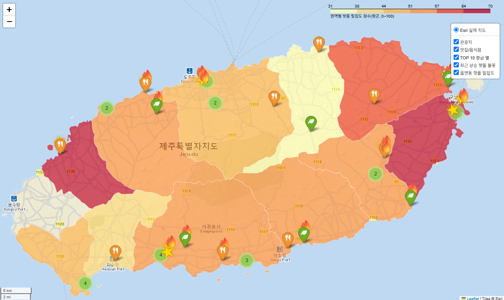
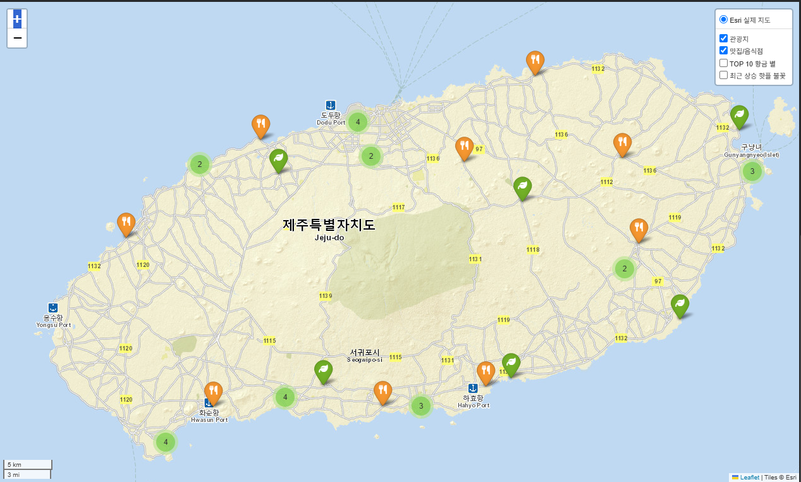
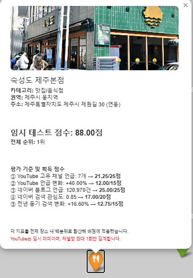

# 제주 핫플레이스 지도 — 4개 API 데이터를 하나의 점수와 지도로

> 단위가 제각각인 5개 지표(검색 관심도, 블로그 언급 수, 유튜브 채널 수 등)를 **백분위 배점으로 표준화**해
> 100점 만점 `hot_score`를 만들고, 읍·면·동 권역 지도로 시각화한 프로젝트입니다.

| 항목 | 내용 |
|---|---|
| 형태 | KB Bridge 부트캠프 미니실습 02 · 4인 팀 (믿는조) |
| 사용 기술 | Python (Pandas, Requests, Folium, Shapely, WordCloud) · REST API 5종 · SQL (SQLite) · Google Colab |
| 데이터 | 제주 관광지 20곳 + 음식점 20곳, API 호출 기반 수집 |
| 핵심 결과 | 40개 장소 순위화, 11개 권역 평균 점수 지도, 상승세 장소 11곳 표시 |

**내 역할** : 실행 검증 및 최종 발표 — API 키 5종을 코드에 연동하고 `.py` 코드를 Colab용 `.ipynb`로 변환해 수집부터 지도 생성까지 실제로 실행되는지 검증



---

## 01. 프로젝트 배경

관광지 정보는 공공데이터(TourAPI)에 정리돼 있지만, "**요즘 실제로 사람들이 찾는 곳인가**"는 알려주지 않습니다.
검색량, 블로그 후기, 유튜브 영상처럼 흩어진 온라인 신호를 모아 장소별로 비교 가능한 하나의 숫자로 만들고 싶었습니다.

## 02. 업무 문제

- 단위와 규모가 다른 지표(검색 상대지수 0~100, 블로그 수십만 건, 채널 수 수십 개)를 어떻게 공정하게 합칠까?
- 누적 인기와 **최근 상승세**를 어떻게 구분해서 보여줄까?
- 결과를 표가 아닌 한 장의 지도로 읽히게 하려면 무엇을 어떻게 표시해야 할까?

## 03. 데이터 설명

| API | 제공처 | 수집 항목 |
|---|---|---|
| TourAPI (KorService2) | 한국관광공사 | 장소명·주소·좌표·대표사진 (관광지 290건 중 20, 음식점 438건 중 20) |
| 로컬 API (역지오코딩) | 카카오 | 좌표 → 읍·면·동 → 14개 권역 |
| Search Trend | 네이버 | 최근 24개월 월별 검색 상대지수 |
| 블로그 검색 | 네이버 | 블로그 언급 총 건수 + 상위 10건 제목·요약 |
| YouTube Data API v3 | Google | 장소별 영상 최대 50건의 채널·게시일·조회수·좋아요·댓글 |
| 행정동 경계 GeoJSON | GitHub 공개 데이터 | 제주 43개 행정동 → 14개 권역으로 병합 |

주요 컬럼(`data/cleaned_data.csv`, 40행)

| 컬럼 | 의미 |
|---|---|
| `zone` | 14개 권역 분류 |
| `naver_interest` / `naver_yoy_growth` | 최근 12개월 평균 검색 관심도 / 전년 동기 대비 증감률 |
| `naver_blog_mentions` | 블로그 언급 총 건수 |
| `youtube_unique_channel_mentions` / `youtube_mention_growth` | 최근 6개월 고유 채널 수 / 이전 6개월 대비 증가율 |
| `hot_score` / `trend_points` | 최종 점수(100점) / 상승세 점수(30점) |

## 04. 데이터 전처리

1. **좌표·이름 정제**: 좌표가 없거나 이름이 빈 행 제거, `이름 + 좌표` 기준 중복 제거
2. **권역 단순화**: 카카오 역지오코딩 결과가 `읍/면`이면 그대로, `동`이면 `제주시 동지역` / `서귀포시 동지역`으로 통합 → 14개 권역
3. **검색 상대지수 정규화**: 네이버 트렌드는 요청 묶음마다 상대값만 주기 때문에, 모든 요청에 기준어 "제주도"를 함께 넣어 묶음 간 비교가 가능하게 맞춤
4. **기간 분할**: 유튜브 게시일을 "최근 6개월 / 이전 6~12개월"로 나눠 채널 언급 증가율 계산
5. **백분위 변환**: 5개 지표를 40개 장소 안에서의 백분위로 바꾼 뒤 배점 적용. 편차가 큰 블로그 수·검색 관심도는 로그 변환 후 순위화
6. **API 한도 대응**: 유튜브 검색은 1회 100 unit(40곳 = 4,000 unit, 일일 한도의 40%). 수집 결과를 `youtube_cache.csv`에 체크포인트로 저장해 한도 초과 시 이어서 수집

## 05. SQL 분석

최종 결과 CSV를 SQLite에 적재해 권역별 요약을 SQL로 확인했습니다. → [`sql/zone_summary.sql`](sql/zone_summary.sql)

```sql
SELECT zone,
       COUNT(*)                 AS n_place,
       ROUND(AVG(hot_score), 1) AS avg_score,
       SUM(is_top10)            AS n_top10,
       SUM(is_fire)             AS n_rising
FROM places
GROUP BY zone
ORDER BY avg_score DESC;
```

| 권역 | 장소 수 | 평균 점수 | TOP10 | 상승세 |
|---|---:|---:|---:|---:|
| 성산읍 | 3 | 65.9 | 2 | 1 |
| 구좌읍 | 2 | 65.3 | 1 | 0 |
| 애월읍 | 4 | 63.2 | 2 | 1 |
| … | | | | |
| 제주시 동지역 | 7 | 48.6 | 2 | **4** |
| 조천읍 | 2 | 19.1 | 0 | 0 |

- 평균 점수 상위 권역은 장소가 2~4곳뿐이라 평균이 쉽게 흔들립니다. 그래서 **장소 수를 항상 같이 표기**했습니다.
- 상승세 장소는 오히려 동지역(제주시 4곳, 서귀포시 3곳)에 몰려 있었습니다.

## 06. Python 분석

```python
score_specs = {
    # 배점 컬럼: (원본 지표, 배점, 로그 변환 여부)
    "youtube_channel_points": ("youtube_unique_channel_mentions", 25, False),
    "youtube_growth_points":  ("youtube_mention_growth",          15, False),
    "naver_blog_points":      ("naver_blog_mentions",             25, True),
    "naver_interest_points":  ("naver_interest",                  20, True),
    "naver_yoy_points":       ("naver_yoy_growth",                15, False),
}
# 각 지표를 백분위(0~100)로 바꾼 뒤 배점을 곱해 합산 → hot_score (100점)
places["trend_points"] = places["youtube_growth_points"] + places["naver_yoy_points"]  # 30점 만점
places["is_fire"] = places["trend_points"].ge(20)                                     # 상승세 표시
```

- 누적 인기(채널 수·블로그·관심도 70점)와 상승세(증가율 2종 30점)를 나눠, **순위는 낮아도 최근 뜨는 장소**를 따로 찾을 수 있게 했습니다.
- 전체 코드: [`source/jeju_hotplace_project.py`](source/jeju_hotplace_project.py) (STEP 1~14 단일 실행), [`source/jeju_hotplace_project.ipynb`](source/jeju_hotplace_project.ipynb)

## 07. 시각화

| 장소 마커 지도 (관광지 초록 / 음식점 주황) | 장소 팝업 — 점수 근거 표시 |
|---|---|
|  |  |

| 블로그 키워드 워드클라우드 |
|---|
|  |

- **Choropleth**: 권역 평균 점수가 높을수록 진한 색
- **황금 별**: 점수 상위 10곳 / **불꽃**: 상승 점수 30점 중 20점 이상
- **팝업**: 사진·주소·총점·순위와 함께 항목별 점수를 보여줘 "왜 이 점수인지" 확인 가능
- 인터랙티브 지도: [`output/jeju_hotplace_map.html`](output/jeju_hotplace_map.html) (다운로드 후 브라우저로 열기)

## 08. 주요 인사이트

| 순위 | 장소 | 구분 | 권역 | 점수 |
|---:|---|---|---|---:|
| 1 | 숙성도 제주본점 | 음식점 | 제주시 동지역 | 89.29 |
| 2 | 한담해변 | 관광지 | 애월읍 | 86.41 |
| 3 | 드르쿰다 | 음식점 | 성산읍 | 78.72 |
| 4 | 고내포구 🔥 | 관광지 | 애월읍 | 77.12 |
| 5 | 가람돌솥밥 🔥 | 음식점 | 서귀포시 동지역 | 76.67 |

- 평균 점수는 음식점(54.4)이 관광지(48.3)보다 높았습니다. 블로그 후기가 음식점에 몰리는 특성이 반영된 결과입니다.
- TOP10 밖이지만 상승세가 뚜렷한 곳: 정의향교(24위, 상승 24.6점), 법화사(11위), 송림반점(16위) — 누적 점수만 봤다면 놓쳤을 장소입니다.
- 블로그 키워드는 지역명(서귀포·애월·중문), 먹거리(카페·맛집·숙성), 자연·코스(올레·해변·산방산) 세 묶음으로 나뉘었습니다.

## 09. 생산·제조 업무 활용 방안

이 프로젝트의 방법론은 "**단위가 다른 여러 지표를 하나의 우선순위로 바꾸는 일**"입니다. 제조 현장에서 개선 대상을 고를 때 그대로 쓸 수 있습니다.

| 이 프로젝트 | 생산·제조 현장 적용 |
|---|---|
| 5개 지표 백분위 → 100점 배점 | 설비·라인별 **불량률, 비가동 시간, 사이클타임 편차, 에너지 사용량**을 백분위로 환산해 개선 우선순위 점수화 |
| 누적 점수 vs 상승세 점수 분리 | 누적 불량 수가 많은 설비와 **최근 불량이 늘고 있는 설비**를 구분 → 예방보전 대상 조기 발견 |
| 권역 Choropleth + 장소 수 병기 | 공장 레이아웃 위 공정별 히트맵. 표본 수가 적은 구역은 평균을 과신하지 않도록 함께 표기 |
| 팝업에 항목별 점수 표시 | 점수만 보여주지 않고 근거 지표를 같이 보여줘야 현장에서 결과를 받아들임 |
| API 한도·캐시 체크포인트 | 설비 데이터 수집이 끊겨도 마지막 지점부터 이어받는 수집 구조 |
| 표본 20곳이라 한라산 누락 | 샘플링 방식(수정일순 앞 20건)이 결과를 왜곡할 수 있음 → 품질 검사 샘플링 설계와 같은 문제 |

## 10. 한계 및 개선 방향

- **표본 한계**: TourAPI를 수정일순 앞 20건씩만 조회해 한라산 같은 대표 관광지가 빠졌습니다. 전체 페이지 수집이 필요합니다.
- **권역 커버리지**: 14개 권역 중 11개 권역에만 장소가 있었고, 권역당 1~9곳이라 평균 비교의 신뢰도가 낮습니다.
- **결측 1건**: 효은디저트(안덕면)는 유튜브 검색 결과가 없어 점수를 계산하지 못했습니다(39곳 점수화).
- **상대 점수**: 백분위 방식이라 40곳 안에서의 상대 순위일 뿐, 장소를 추가하면 점수가 바뀝니다.
- **동명 장소**: 장소명으로 검색하므로 이름이 흔한 장소는 블로그·유튜브 수치가 부풀 수 있습니다.

---

### 실행 방법

```bash
pip install pandas requests folium wordcloud matplotlib shapely tqdm
python source/jeju_hotplace_project.py   # Colab 기준 코드 (보안 비밀에 API 키 5개 등록 필요)
python sql/run_sql.py                    # 결과 CSV로 SQL 요약 실행 (API 키 불필요)
```

필요 API 키: `TOUR_API_KEY`, `KAKAO_REST_KEY`, `NAVER_CLIENT_ID`, `NAVER_CLIENT_SECRET`, `YOUTUBE_API_KEY` (코드에 키를 직접 쓰지 않음)

### 폴더 구조

```
02_제주핫플레이스지도/
├─ README.md
├─ source/   # 수집·정제·점수·지도 전체 코드 (.py / .ipynb)
├─ data/     # raw_data.csv, cleaned_data.csv, youtube_cache.csv, 행정동 GeoJSON
├─ sql/      # 권역 요약 SQL + 실행 스크립트
├─ output/   # 인터랙티브 지도 HTML, 워드클라우드
└─ images/   # README용 캡처
```
